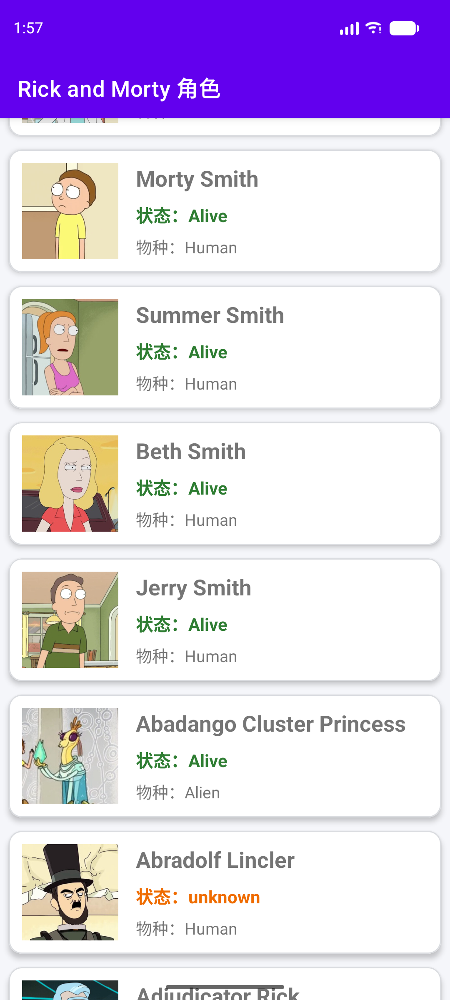
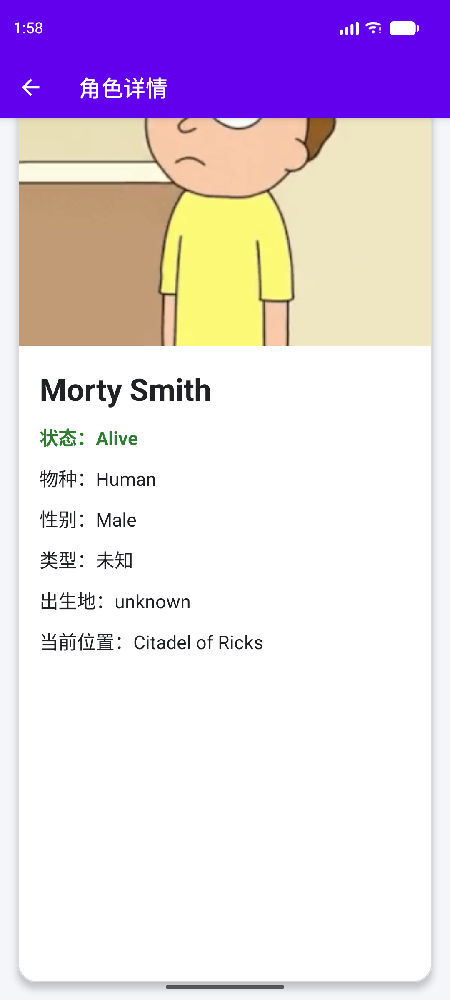

姓名：白彪

# Android 作业 - 网络请求 & RecyclerView

## 🎯 目标

使用 Retrofit 或其他网络工具，调用以下 API 并展示角色列表：

https://rickandmortyapi.com/api/character

该 API **无需 API Key**，直接 GET 即可。默认返回第 1 页，共 20 条数据。

API 文档参考：https://rickandmortyapi.com/documentation

每个列表条目需要显示：

| 字段 | JSON 字段 | 说明 |
|------|-----------|------|
| 头像 | `image` | 网络图片 URL，需加载展示 |
| 名字 | `name` | 角色名称 |
| 状态 | `status` | `Alive` / `Dead` / `unknown` |
| 物种 | `species` | 如 `Human`、`Alien` 等 |

## ✅ 基本要求

- 使用 **RecyclerView** 显示数据
- 使用 **Glide** 或 **Coil** 加载头像（`image` 字段）
- **不同 status 使用不同颜色** 区分展示，例如：
  - `Alive` → 绿色
  - `Dead` → 灰色或红色
  - `unknown` → 橙色或黄色  
  （具体色值可自行选择，需能明显区分三种状态）
- 数据加载成功后更新 UI
- 如果加载失败，显示 **Toast** 提示
- 在 `AndroidManifest.xml` 中添加网络权限（`INTERNET`）

## 💡 加分项

- 显示 **Loading** 状态
- 使用 **ViewModel + LiveData / Flow** 架构
- 分页加载（使用 `info.next` 或 `?page=2` 加载更多）
- 美化 UI（Material 组件、CardView、布局优化）
- 点击 item 进入详情页（可使用 `url` 字段请求单个角色详情）

## 🚀 如何开始

1. 使用我们发送的链接创建属于你自己的仓库副本：  
   https://github.com/shawnX7/android-interview-template/generate
2. 点击 **Create repository**（仓库需设置为 **Public**，或 Private 并 invite 面试官）
3. Clone 到本地，用 Android Studio 打开项目
4. 在本 README **第一行** 填写你的真实姓名
5. 完成作业后 push 到你的仓库

## 📦 提交方式

1. 将代码 **push** 到你的 GitHub 仓库
2. 在本 README **第一行填写真实姓名**，并在下方「作业说明」中补充开发过程、遇到的问题、心得、架构说明、截图等
3. 确保仓库为 **Public**（公开），以便面试官查看
4. 完成提交后，请联系 HR 确认，并附上你的仓库链接，例如：  
   `https://github.com/YOUR_USERNAME/YOUR_REPO_NAME`

## ⏱ 建议时间

本作业预计花费约 **3 小时** 完成，若需更多时间可自行延长。

---

## 📝 作业说明（完成后填写）

### 完成情况

- [x] Retrofit + Gson 请求角色列表
- [x] RecyclerView 展示头像、名称、状态和物种
- [x] Coil 加载网络头像
- [x] Alive、Dead、unknown 使用不同颜色
- [x] 首次加载 Loading、失败 Toast、错误页面和重试按钮
- [x] ViewModel + StateFlow + Repository 架构
- [x] 根据 `info.next` 滚动分页
- [x] MaterialCardView 列表卡片与详情页 UI
- [x] 点击列表项请求并展示角色详情
- [x] ViewModel 分页单元测试

### 开发过程

1. 根据 API 返回结构建立角色、分页信息和地点等数据模型。
2. 使用 Retrofit + Gson 实现角色列表和单角色详情请求。
3. 使用 Repository 接口隔离网络数据源，通过 ViewModel Factory 向页面状态层注入依赖。
4. 通过 ViewModel + StateFlow 管理首次加载、加载成功、加载失败和分页加载状态；Activity 使用 `repeatOnLifecycle` 安全收集状态。
5. 使用 RecyclerView + ListAdapter + DiffUtil 展示角色，通过 Coil 异步加载并缓存头像。
6. 根据 Alive、Dead、unknown 三种状态显示绿色、红色和橙色。
7. 监听列表滚动位置，在接近底部时自动请求下一页，并根据 `info.next` 判断是否还有更多数据。
8. 点击角色卡片进入详情页，根据角色 ID 请求单角色接口，展示状态、物种、性别、类型、出生地和当前位置。
9. 为首次加载、分页追加和分页失败保留旧数据编写本地单元测试，并完成 Debug APK 构建与 Android Lint 检查。

### 遇到的问题 & 解决方案

- **项目路径包含中文导致 Gradle 构建失败**：将项目移动到纯英文目录 `D:\AndroidProjects\android-interview-assessment`。
- **新版 Coil/Lifecycle 引入的 Kotlin 版本高于模板编译器支持范围**：选择与当前模板兼容的 Coil 2.7.0 和 Lifecycle 2.9.4，避免 Kotlin 元数据版本冲突。
- **分页失败时不应清空已经加载的内容**：保留现有列表，通过带“重试”操作的 Snackbar 提示用户。
- **页面退出时协程取消可能被误判为网络错误**：单独捕获并重新抛出 `CancellationException`，只把真实请求异常转换成错误状态。
- **图片首次安装后出现临时失败占位图**：清理旧应用数据并重新安装验证，确认网络权限、图片地址和 Coil 加载均正常。

### 架构说明

- `data/model`：API 数据模型。
- `data/remote`：Retrofit 接口与客户端。
- `data/repository`：通过接口统一管理列表和详情请求，正式环境使用 Retrofit 实现，测试可替换为假数据实现。
- `ui/character`：列表状态、ViewModel 和 RecyclerView Adapter。
- `ui/detail`：详情状态、ViewModel 和详情 Activity。
- 数据从 Repository 流向 ViewModel，再以 StateFlow 形式流向 Activity；点击、重试和滚动分页事件从 Activity 传回 ViewModel，形成单向数据流。
- Activity 只负责渲染状态和处理界面交互，网络请求、分页合并和错误状态由 ViewModel 管理。

### 测试与验证

- `testDebugUnitTest`：通过，共 4 项测试，0 失败、0 错误。
- `assembleDebug`：通过，成功生成 Debug APK。
- `lintDebug`：通过，无 Lint Error；保留的 Warning 仅为兼容版本与布局结构建议。
- Pixel 7 API 37 模拟器实测：列表、网络图片、三种状态颜色、自动分页、详情请求和返回导航均正常。

### 开发心得

本作业重点不只是完成一次网络请求，还需要把加载、成功、失败和分页等状态清晰地建模。通过 Repository、ViewModel 和 StateFlow 分离数据请求与界面渲染后，页面逻辑更容易维护，也可以使用假 Repository 对分页行为进行稳定测试。依赖版本选择同样需要考虑模板的 Kotlin 和 Android Gradle Plugin 兼容性，并非版本越新越合适。

### 截图

| 角色列表与分页 | 角色详情 |
|---|---|
|  |  |

---

感谢你花时间完成本次招聘作业，期待你的精彩作品！
